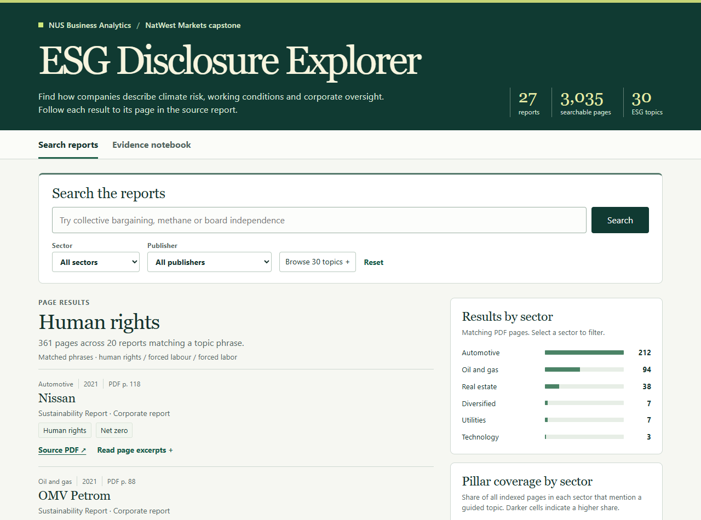
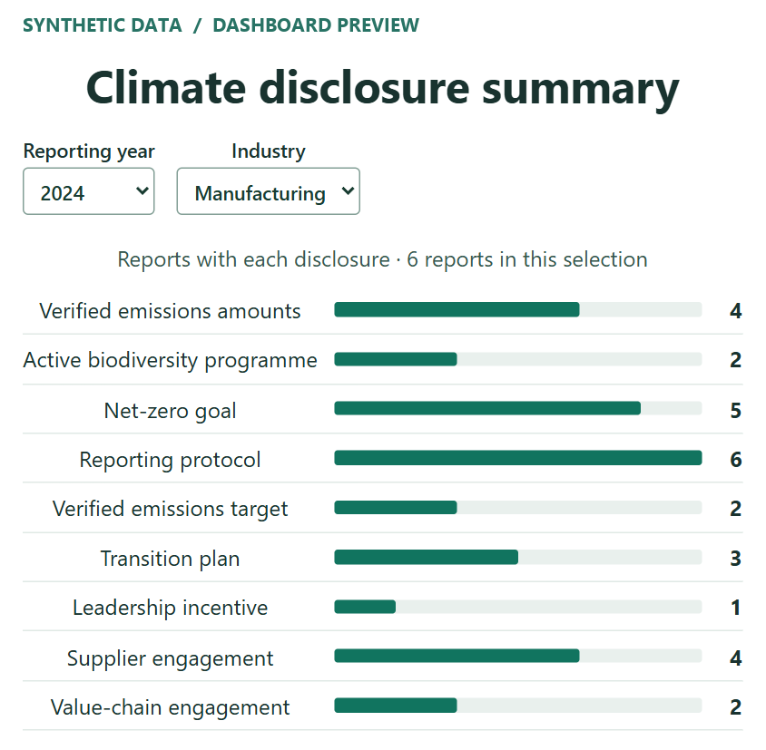

# ESG Disclosure Dashboard

[**Open the live ESG Disclosure Explorer →**](https://fancasta.github.io/climate-disclosure-explorer/)　·　[Evidence notebook](https://fancasta.github.io/climate-disclosure-explorer/?view=notes)　·　[Research pipeline](https://github.com/fancasta/climate-disclosure-explorer)

How do companies describe water use, labour rights or board oversight, and where is the supporting passage? Search 3,035 extractable pages from 27 reports. Run a keyword search, choose one of 30 ESG topics or narrow the results to a publisher or sector. Every hit carries a PDF page reference.

This dashboard grew out of the **NUS Business Analytics capstone for NatWest Markets**, August–December 2022. The team used machine learning to explore decarbonisation strategies. The original React, Node.js and MySQL application compares company indicators by sector and reporting year. The later public dashboard extends that work across environmental, social and governance topics.

| Guided search | Matching pages | Reports |
| --- | ---: | ---: |
| [Water stewardship](https://fancasta.github.io/climate-disclosure-explorer/?topic=Water+stewardship) | 126 | 24 |
| [Collective bargaining](https://fancasta.github.io/climate-disclosure-explorer/?topic=Collective+bargaining) | 55 | 16 |
| [Board independence](https://fancasta.github.io/climate-disclosure-explorer/?topic=Board+independence) | 24 | 9 |

Try a custom search for [methane leakage](https://fancasta.github.io/climate-disclosure-explorer/?q=methane+leakage). Oracle’s publisher serves the full PDF in its own viewer. Selected Oracle pages have verified excerpts and editorial notes in the explorer. The sector chart updates with the results. The heatmap shows the percentage of all indexed pages per sector containing a guided topic in each pillar. Topics overlap. Open a result to read source excerpts, or use the notebook for ten annotated examples and six reproducible page-ranking cases.

## From report rows to disclosure counts

The dashboard groups records in one pass by reporting year and industry. Each row contributes one to the group total. An affirmative indicator contributes one to that disclosure's count. Missing indicators contribute zero to the count and the report stays in the denominator. The filter lists come from groups present in the data.

This screenshot uses the [synthetic report fixture](examples/mock-reports.json). Six of its eight rows are manufacturing reports from 2024. Five of those six disclose a net-zero goal and three disclose a transition plan. The other two rows belong to different groups. [Aggregation code](frontend/src/components/disclosures.js) · [Filter and aggregation tests](frontend/src/components/DataSummary.test.js)

## Explore the dashboard

- **Look up a company.** Selecting a company loads its reports through the backend API. The company view lets readers move from a summary to individual report records. [Dashboard page](frontend/src/pages/HomeDashboard.js) · [Report table](frontend/src/components/ReportTable.js)
- **Compare reporting practices.** The summary groups report records by year and industry. Its chart counts indicators such as verified emissions amounts, net-zero goals, transition plans and supplier engagement. The bars count disclosures in the dataset. They do not measure tonnes of emissions or progress towards a target. [Aggregation logic](frontend/src/components/DataSummary.js) · [Chart](frontend/src/components/SummaryChart.js)

## How the application fits together

The React frontend requests company and report records from a Node.js backend. The backend reads from MySQL, and the repository includes a SQL backup for the project database. [API routes](backend/routes) · [Database files](mysql) · [Docker Compose setup](docker-compose.yml)

## Run locally

With Docker running, execute `docker compose up --build` from the repository root. Open `http://localhost:3000`, select a company and inspect its reports, or choose a year and industry in the summary chart. The API uses port `6868` and the local Adminer database viewer uses port `8000`. Run `docker compose down` to stop the services.

## Build the public demo

In `frontend`, run `npm ci`, set `REACT_APP_PUBLIC_DEMO=true`, `PUBLIC_URL=/climate-disclosure-explorer` and `GENERATE_SOURCEMAP=false`, then run `npm run build`. The build includes the page index and a PDF.js reader. The research repository serves these files from its `gh-pages` branch. The local full-stack app also exposes the public search at `/explore`.

The [source manifest](search/sources.json) pins PDF editions with SHA-256. To rebuild the index, install PyMuPDF, clone the [research repository](https://github.com/fancasta/climate-disclosure-explorer), and download its three [additional publisher PDFs](https://github.com/fancasta/climate-disclosure-explorer/blob/main/examples/public-reports.json) into a separate folder. Run `python search/build_index.py PATH_TO_RESEARCH PATH_TO_PUBLISHER_PDFS` from this repository. The index retains physical page numbers and excludes seven pages without indexable terms.

[Topic phrases](search/topics.json) · [Index builder](search/build_index.py) · [BM25 ranking and filters](frontend/src/corpusSearch.js)
