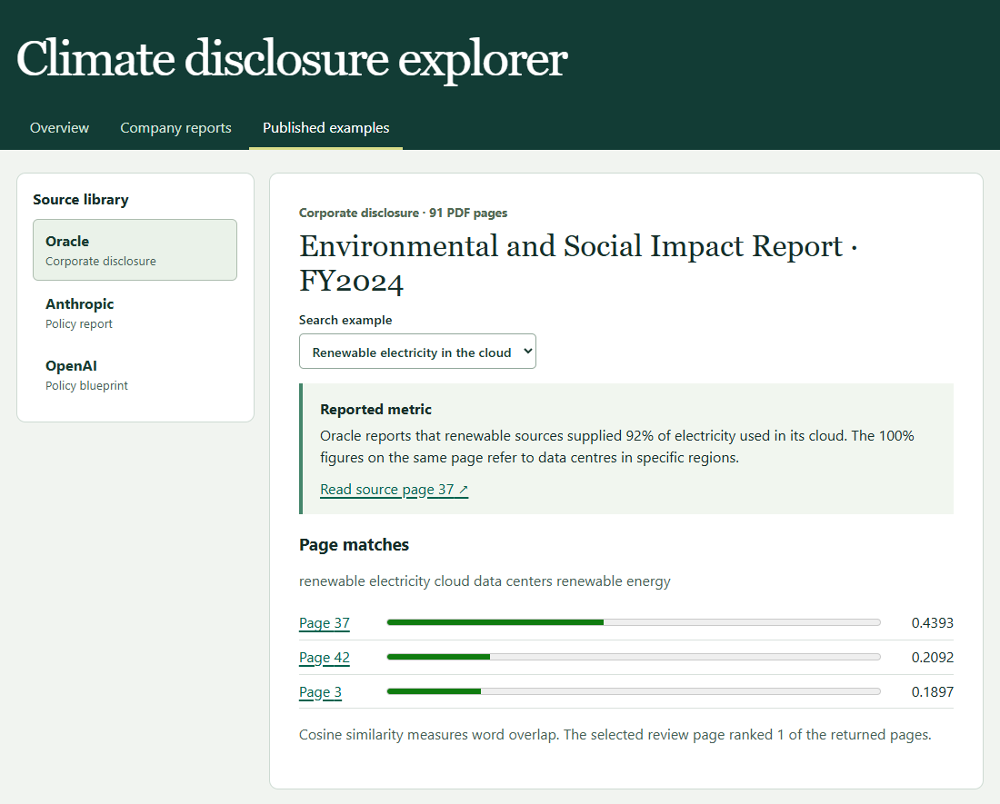

# Exploring corporate climate disclosures

Which companies report a net-zero goal or a transition plan, and how common are those disclosures within an industry? This capstone dashboard lets a reader search for a company, inspect its reports and compare counts of reported practices across industries and years.

The dashboard opens on the reporting overview. Use **Company reports** to inspect an individual filing or **Published examples** to explore page-level findings from Oracle, Anthropic and OpenAI. The published examples are available even when the local report API is offline. [Case-study methods and sources](https://github.com/fancasta/climate-disclosure-explorer/blob/main/CASE_STUDIES.md)

## From report rows to disclosure counts

The dashboard groups records in one pass by reporting year and industry. Each row contributes one to the group total. An affirmative indicator contributes one to that disclosure's count. Missing indicators contribute zero to the count and the report stays in the denominator. The filter lists come from groups present in the data.

This screenshot uses the [synthetic report fixture](examples/mock-reports.json). Six of its eight rows are manufacturing reports from 2024. Five of those six disclose a net-zero goal and three disclose a transition plan. The other two rows belong to different groups. [Aggregation code](frontend/src/components/disclosures.js) · [Filter and aggregation tests](frontend/src/components/DataSummary.test.js)

## Explore the dashboard

- **Look up a company.** Selecting a company loads its reports through the backend API. The company view lets readers move from a summary to individual report records. [Dashboard page](frontend/src/pages/HomeDashboard.js) · [Report table](frontend/src/components/ReportTable.js)
- **Compare reporting practices.** The summary groups report records by year and industry. Its chart counts indicators such as verified emissions amounts, net-zero goals, transition plans and supplier engagement. The bars count disclosures in the dataset. They do not measure tonnes of emissions or progress towards a target. [Aggregation logic](frontend/src/components/DataSummary.js) · [Chart](frontend/src/components/SummaryChart.js)

## How the application fits together

The React frontend requests company and report records from a Node.js backend. The backend reads from MySQL, and the repository includes a SQL backup for the project database. [API routes](backend/routes) · [Database files](mysql) · [Docker Compose setup](docker-compose.yml)

## Run locally

With Docker running, execute `docker compose up --build` from the repository root. Open `http://localhost:3000`, select a company and inspect its reports, or choose a year and industry in the summary chart. The API uses port `6868` and the local Adminer database viewer uses port `8000`. Run `docker compose down` to stop the services.
